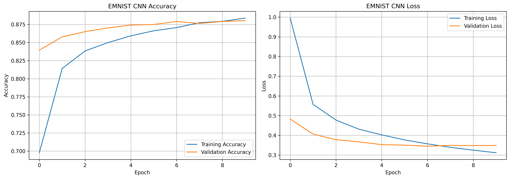
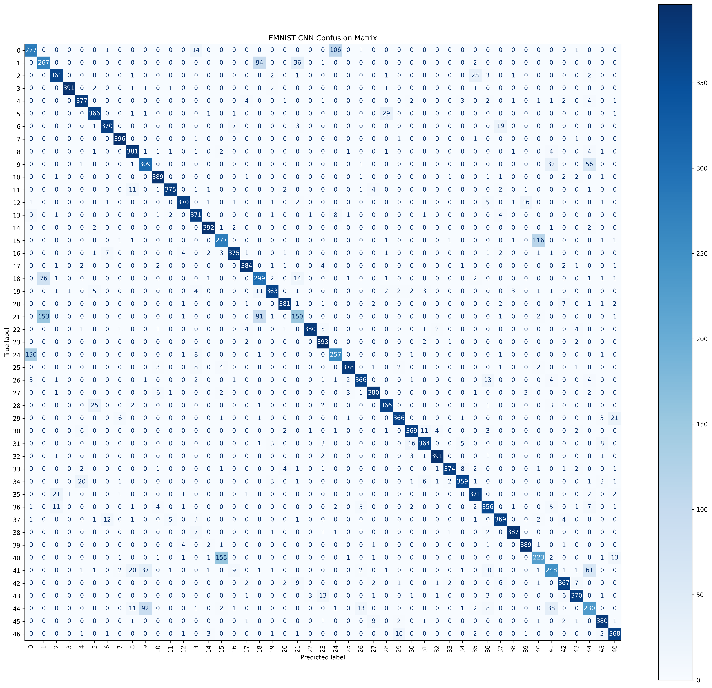
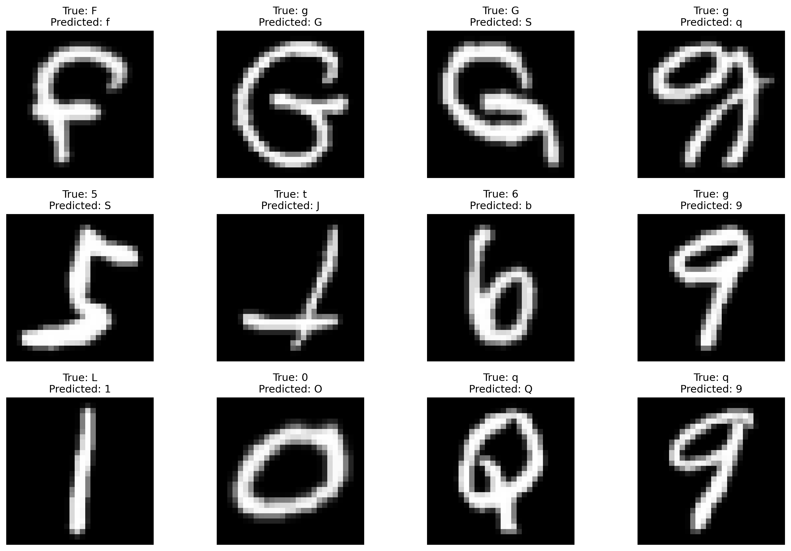

# Handwritten Character Recognition Using CNN

### CodeAlpha Machine Learning Internship — Task 3

##  Project Overview

This project implements a Handwritten Character Recognition system using **Deep Learning** and **Convolutional Neural Networks (CNN)**.

The system is designed to recognize handwritten digits and English characters using two datasets:

- **MNIST:** Handwritten digit recognition (0–9).
- **EMNIST Balanced:** Handwritten digits and English letters across 47 classes.

The project covers data preprocessing, CNN model development, training, evaluation, error analysis, and custom handwriting prediction.
## 🌐 Live Demo

Try the Handwritten Character Recognition application online!

**Live Application:** https://handwriting-recognition-ai.streamlit.app/

The application allows users to:
- Draw handwritten characters directly.
- Upload images containing handwritten letters or digits.
- View predictions from the trained CNN model.
- Explore confidence scores and alternative predictions.
##  Project Objectives

- Develop CNN models for handwritten character classification.
- Preprocess and normalize image datasets.
- Train and evaluate deep learning models.
- Analyze classification errors using confusion matrices.
- Evaluate performance using Precision, Recall, F1-Score, and Accuracy.
- Test the trained model on custom handwritten images.

##  Technologies Used

- Python
- TensorFlow / Keras
- TensorFlow Datasets
- NumPy
- Matplotlib
- Scikit-learn
- Pillow
- Google Colab

## Datasets

### 1. MNIST Dataset

MNIST contains 70,000 grayscale handwritten digit images.

| Property | Value |
|---|---|
| Training Images | 60,000 |
| Testing Images | 10,000 |
| Image Size | 28 × 28 |
| Classes | 10 |

### 2. EMNIST Balanced Dataset

EMNIST Balanced contains handwritten digits and English characters.

| Property | Value |
|---|---|
| Training Images | 112,800 |
| Testing Images | 18,800 |
| Image Size | 28 × 28 |
| Classes | 47 |

For model development, the original EMNIST training dataset was divided into 90% training and 10% validation data.

##  CNN Architecture

The models use Convolutional Neural Networks to automatically extract visual features from handwritten images.

### EMNIST Model Architecture

```text
Input Layer (28 × 28 × 1)
          ↓
Conv2D (32 Filters, 3×3, ReLU)
          ↓
MaxPooling2D (2×2)
          ↓
Conv2D (64 Filters, 3×3, ReLU)
          ↓
MaxPooling2D (2×2)
          ↓
Flatten
          ↓
Dense (128, ReLU)
          ↓
Dropout (0.3)
          ↓
Dense (47, Softmax)
```

The model was compiled using:

- **Optimizer:** Adam
- **Loss Function:** Sparse Categorical Crossentropy
- **Evaluation Metric:** Accuracy

EarlyStopping and ModelCheckpoint were used during EMNIST training.

##  Data Preprocessing

The preprocessing pipeline includes:

1. Converting images to floating-point values.
2. Normalizing pixel values from 0–255 to 0–1.
3. Correcting EMNIST image orientation.
4. Preparing images in 28 × 28 × 1 format.
5. Applying batching, shuffling, and prefetching.

For custom handwritten images, additional processing was performed to isolate, resize, and center the handwritten character.

##  Model Performance

Both CNN models were evaluated on their respective held-out test datasets.

| Metric | MNIST | EMNIST Balanced |
|---|---:|---:|
| Test Accuracy | 98.98% | 87.35% |
| Test Loss | 0.0356 | 0.3669 |
| Number of Classes | 10 | 47 |
| Test Images | 10,000 | 18,800 |

The EMNIST classification report produced:

- **Macro Precision:** 87.50%
- **Macro Recall:** 87.35%
- **Macro F1-Score:** 87.26%

The two datasets represent different classification tasks, so their accuracy values should not be interpreted as a direct comparison of model quality.

## Training Results

The following visualization shows training and validation accuracy and loss for the EMNIST CNN model.



##  Confusion Matrix

The confusion matrix illustrates the model's classification performance across 47 classes.



##  Error Analysis

The EMNIST model incorrectly classified 2,378 images out of 18,800 test samples.

Several errors occurred between visually similar characters, including:

- Uppercase F and lowercase f
- Letter O and digit 0
- Letter I and digit 1
- Letter L and digit 1
- Lowercase g and q

These results highlight the challenges of distinguishing visually similar handwritten characters.



##  Custom Handwriting Recognition

The trained EMNIST model was tested on an external image containing the handwritten letter **B**.

During the initial test, the model incorrectly classified the image because the original preprocessing pipeline included unwanted background elements.

After improving image cropping, background removal, and resizing, the model successfully recognized the handwritten letter.

**Test Result:**

```text
Input Character: B
Predicted Class: 11
Predicted Character: B
```

This experiment demonstrated the importance of preprocessing when applying a model to images outside its training dataset.

## 📁 Project Structure

```text
CodeAlpha_Handwritten_Character_Recognition/
│
├── README.md
│
├── requirements.txt
│
├── notebooks/
│   ├── MNIST_Digit_Recognition.ipynb
│   └── EMNIST_Character_Recognition.ipynb
│
├── images/
│   ├── emnist_confusion_matrix.png
│   ├── emnist_training_curves.png
│   └── emnist_error_analysis.png
│
└── models/
    └── emnist_final_model.keras
```

##  How to Run

### 1. Clone the repository

```bash
git clone https://github.com/Dania-Yasir/CodeAlpha_Handwritten_Character_Recognition.git
```

### 2. Install dependencies

```bash
pip install -r requirements.txt
```

### 3. Open the notebooks

Open the notebooks using Google Colab or Jupyter Notebook.

Execute the cells in order to reproduce the data preparation, model training, and evaluation workflows.

### 4. Load the trained EMNIST model

```python
import tensorflow as tf

model = tf.keras.models.load_model(
    "models/emnist_final_model.keras"
)
```

Input images must be preprocessed into the same format used during training.

## Future Improvements

Potential improvements include:

- Data augmentation to improve generalization.
- Experimenting with more advanced CNN architectures.
- Improving recognition of visually similar characters.
- Developing an interactive Streamlit application.
- Supporting multiple handwritten characters in a single image.

## Conclusion

This project demonstrates the application of Convolutional Neural Networks to handwritten character recognition.

The MNIST model achieved **98.98% test accuracy**, while the EMNIST Balanced model achieved **87.35% test accuracy** across 47 classes.

The project also demonstrates the importance of data preprocessing, model evaluation, and error analysis in real-world machine learning applications.

---

**Developed by Dania Yasir**

**CodeAlpha Machine Learning Internship | Task 3**
